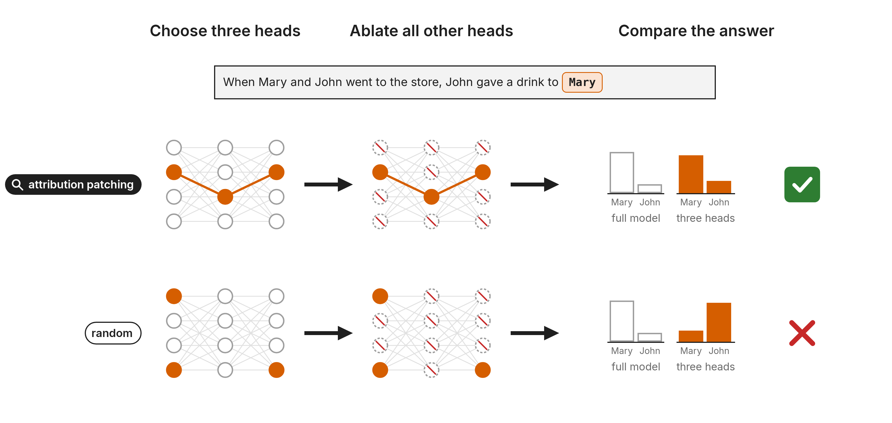
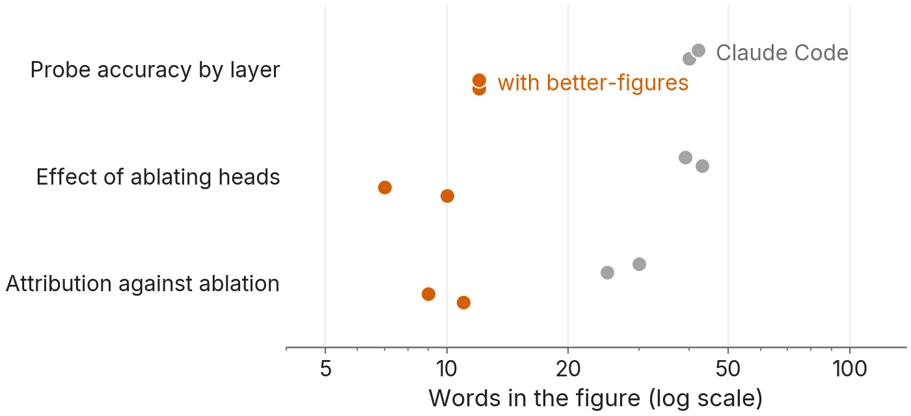

# better-figures

A Claude Code skill for making research figures that a busy researcher understands in five seconds. It is written for interpretability researchers who use Claude Code to run experiments and plot the results, though nothing in it is specific to interpretability.

Left to itself, Claude tends to make figures that show every result at once and put the caption's job into the image: sentence titles, definitions, statistics and verdicts drawn above the data. Asking it to "define every term" makes the labels longer. This skill asks a different question before and after drawing: what can be removed?



*A summary figure drawn with the skill's HTML parts. The result it shows is made up: three attention heads chosen by attribution patching keep the model's answer to the prompt when every other head is ablated, and three random heads do not.*

## What it does

The plugin has two parts.

**The skill** (`skills/figures/`) loads when Claude is about to make a figure. It has Claude:

- write a short plan before drawing: the one claim the figure argues, the plot template that makes that argument, the one comparison it shows, and every string that will appear in the image;
- keep definitions, n, intervals and verdicts in the caption, with axis labels and series names next to the data the only text in the image;
- draw with a matplotlib house style (`figkit.py`) that labels lines and bars directly and runs a check on save, which prints what to fix: too many words, a legend that could be direct labels, sentence titles, small or overlapping text;
- draw figures for web pages in HTML and SVG, with exact values in a tooltip, and render a PNG from the same file for slides;
- draw method diagrams and summary figures (the Figure 1 that opens a paper) from HTML parts: chat boxes, a model icon, thought bubbles, network cartoons, ablation marks, check and cross badges;
- look at the rendered PNG once, and for figures going to a mentor or a paper, ask a fresh subagent with none of the context what the figure says.

**The workflow** ([`WORKFLOW.md`](WORKFLOW.md)) covers the part a skill can't enforce on its own: figures are designed at the spec stage, before an experiment runs. You approve each figure as its plan block, or as a mock drawn from fake data, never as a prose description of its encodings. Each figure argues one claim, a set of experiments gets at most five figures, and they are published together on one page, each with a short caption. `WORKFLOW.md` ends with a block of rules you can paste into your own `CLAUDE.md`.

## Install

As a plugin, inside Claude Code:

```
/plugin marketplace add wmayner/better-figures
/plugin install better-figures@better-figures
```

On Claude Code 2.1.275 or later, `/plugin install better-figures --marketplace wmayner/better-figures` does both in one step.

Or copy the skill into your personal skills folder:

```
git clone https://github.com/wmayner/better-figures
cp -r better-figures/skills/figures ~/.claude/skills/
```

Either way, Claude loads the skill when you ask for a figure. You can also call it directly: `/better-figures:figures` for the plugin, `/figures` for the copy.

### Requirements

- Python with matplotlib for `figkit.py`; seaborn is optional. The Inter font ships in `skills/figures/fonts/`, and the style falls back to DejaVu Sans without it.
- A headless Chromium for `render_html.sh`, which turns HTML figures and diagrams into PNGs. The script looks for Playwright's headless shell (`uvx playwright install chromium-headless-shell`, or the `npx` equivalent), then Google Chrome or chromium, or uses the path in `$CHROME`.
- A network connection for the interactive example, which loads D3 from jsDelivr and Inter from Google Fonts.

## Examples

`skills/figures/examples/` has one worked example of each kind of figure, each with its source and the rendered PNG. All their data is made up.

| Example | Kind |
|---|---|
| `bar_comparison.py` | bar plot: the loss increase from ablating the top heads by activation patching against random heads, on four tasks |
| `line_direct_labels.py` | line plot with names at the line ends: probe accuracy by layer, against two controls |
| `interactive_dots.html` | HTML figure with a tooltip: how closely four attribution methods rank heads the way ablation does |
| `diagram.html` | method diagram: the three steps of activation patching |
| `summary_example.html` | summary figure, shown above |
| `summary_components.html` | each HTML part of a summary figure once, to copy from |

To re-render them, run the Python scripts with any working directory, and `sh skills/figures/render_html.sh <file>.html <file>.png <width> <height>` for the HTML files (the size of each is in a comment at its top).

## References

The rules for summary figures come from the first figures of five papers by Owain Evans's group: Connecting the Dots, the Reversal Curse, Subliminal Learning, Emergent Misalignment, and Tell Me About Yourself. These papers are under arXiv's default license, which doesn't allow redistribution, so their images are not in this repository. Run `sh skills/figures/references/fetch-references.sh` to download the pages from arXiv for your own reference. A sixth figure, from How to Catch an AI Liar, is under CC BY 4.0 and ships in the folder. [`skills/figures/references/README.md`](skills/figures/references/README.md) lists each paper with its license and the thread on X that announced it, with notes on what each figure does well.

The plot templates the skill chooses from (bar, line, scaling law, calibration, diverging line, Pareto frontier) come from Jo Jiao's post [Research lessons I learned at MATS and Redwood](https://www.lesswrong.com/posts/Q4rcvgjbgjTwmn8Xa/research-lessons-i-learned-at-mats-and-redwood), which argues that a plot is an argument in miniature and that plots matching a known template are much easier to read.

## Does it work?

<!-- EVIDENCE -->
We ran a small test on 20 October 2026. Claude Code (Opus 5.5, effort high, headless) got the same made-up dataset and the same one-line request in two setups. Plain Claude Code had no CLAUDE.md, user skills, plugins, hooks or MCP servers; it still had Claude Code's built-in skills, and it loaded the built-in `dataviz` skill in every run. The other setup was identical except for `--plugin-dir` pointing at this repository, and it loaded the figures skill in every run. Each run started in an empty directory holding only `data.csv`.

There were three tasks, each with a planted answer: probe accuracy by layer for four concepts that become decodable at different depths ("Make a figure showing where each concept becomes decodable"), the loss increase from ablating each of 144 heads where three heads matter, and five attribution methods compared with ablation on three models where one method is clearly best. Each setup ran each task twice, for 12 runs.

We measured two things. The first is the number of words in the image other than tick labels (axis labels, titles, legends, annotations), counted from the matplotlib text objects. The second is a fresh-reader check: a new session saw only the PNG and wrote one sentence on what it shows, and a separate session compared that sentence with the planted answer and said whether they match (yes, partly or no) without knowing which setup drew the figure.



*Each dot is one run of Claude Code (Opus 5.5) given the same data and request; grey runs were plain Claude Code, orange runs had better-figures installed. Words exclude tick labels; 2 runs per setup per task. Fresh-reader agreement is in the table below.*

| Task | Mean words: plain / with plugin | Fresh reader matched: plain / with plugin | Cost per run (USD): plain / with plugin |
|---|---|---|---|
| Probe accuracy by layer | 41 / 12 | 2 of 2 / 2 of 2 | 0.55 / 0.71 |
| Effect of ablating heads | 41 / 8.5 | 2 of 2 / 2 of 2 | 0.50 / 0.38 |
| Attribution against ablation | 27.5 / 10 | 2 of 2 / 1 of 2, 1 partly | 0.33 / 0.28 |

With the plugin, figures carried 2.8 to 4.8 times fewer words depending on the task (geometric mean 3.6), and every plugin run used fewer words than every plain run. With only three tasks the statistical evidence is moderate: a Bayes factor of 4.9 for the per-task log ratio of mean words differing from zero (one-sample JZS test, Cauchy prior with scale 0.707), and 6.0 with scale 1.0. The fresh reader got the planted answer from almost every figure in both setups, so on these tasks plain Claude Code's figures were not harder to read; the plugin's figures said the same thing with less text. The one partial match was a plugin figure whose reader gave the ranking of methods without saying how far ahead the best one was. Cost per run was the same on average ($0.46 in both setups; this is the API-equivalent cost Claude Code reports). These are 12 runs on made-up data with one model, so treat them as a first check, not a benchmark.

The first run of each setup on the attribution task:


To rerun the test, from `evals/`: `python make_data.py --seed 20261020 --out runs/<new name>`, then `python run.py isolation`, `run.py draw`, `measure.py`, `run.py read` and `analyze.py` on that folder (the usage block at the top of `evals/run.py` lists them in order; `evals/requirements.txt` has the Python packages). Each run's script, figure, caption, cost and token counts are in `evals/runs/2026-10-20_seed20261020/`, with the paths of the machine it ran on replaced by `<repository>` and `<work_root>`. The full session transcripts are not in the repository: `run.py` writes them to a `transcripts/` folder in the run folder, which git ignores.
<!-- /EVIDENCE -->

## License

MIT, copyright 2026 Will Mayner; see [`LICENSE`](LICENSE). The Inter font is under the SIL Open Font License 1.1 (`skills/figures/fonts/Inter-LICENSE.txt`). The figure from How to Catch an AI Liar is under CC BY 4.0 by its authors.
